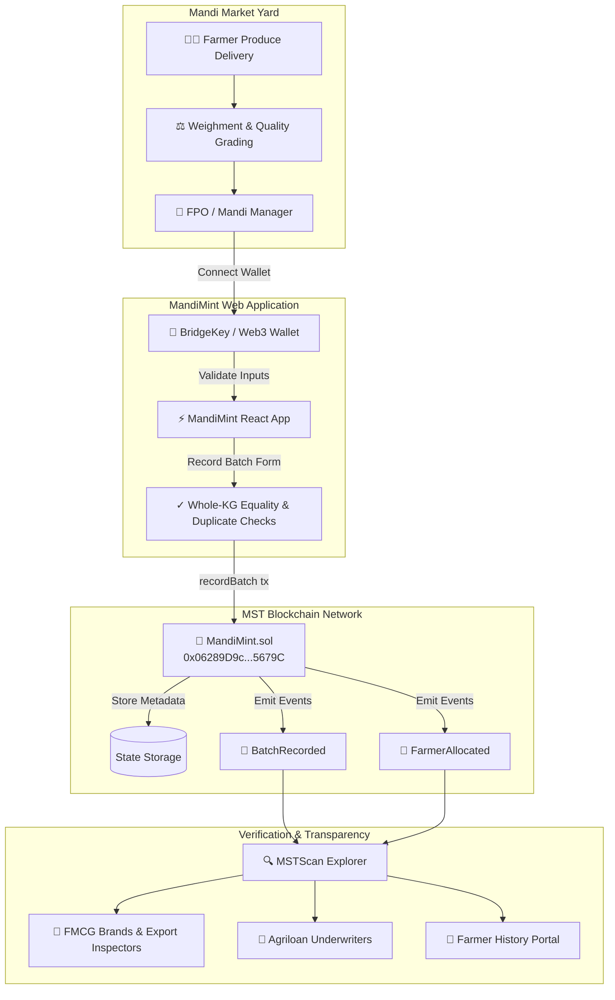

# 🌱 MandiMint · MST Blockchain Buildathon 2.0

> **Decentralized Agricultural Produce Traceability & Cryptographic Recordkeeping on MST Blockchain**
> Built for the **MST Buildathon 2.0** · Track: Real-World Use Cases & Enterprise Infrastructure

[-059669?style=for-the-badge&logo=blockchain&logoColor=white)](https://testnet.mstscan.com/address/0x06289D9c452369abcb9bc1b5D6Adf80982C5679C)
[](https://mariorpc.mstblockchain.com/)
[](https://bridgekey.io/)
[](https://soliditylang.org/)
[](LICENSE)

---

## 🏆 MST Buildathon 2.0 Submission Summary

| Requirement | Implementation Detail | Status |
|---|---|---|
| **Contract Name** | `MandiMint.sol` | Verified & Deployed |
| **MST Testnet Contract Address** | [`0x06289D9c452369abcb9bc1b5D6Adf80982C5679C`](https://testnet.mstscan.com/address/0x06289D9c452369abcb9bc1b5D6Adf80982C5679C) | 🟢 Live On-Chain |
| **Creation Transaction Hash** | [`0xb2a1ecfa0766be71652afa34694ec880d2787681745181d0e7cff6cb36adcadf`](https://testnet.mstscan.com/tx/0xb2a1ecfa0766be71652afa34694ec880d2787681745181d0e7cff6cb36adcadf) | 🟢 Confirmed Block 2268305 |
| **Deployer / Owner Address** | [`0xEDe9ca4BfA8e06A1fB832F2F19686b329863CEF0`](https://testnet.mstscan.com/address/0xEDe9ca4BfA8e06A1fB832F2F19686b329863CEF0) | 🟢 ~110 tMSTC Balance |
| **MST Testnet Chain ID** | `91562037` (`0x5752035`) | Configured & Enforced |
| **MST Testnet RPC** | `https://testnetrpc.mstblockchain.com` | Official Endpoint |
| **MST Block Explorer** | [`https://testnet.mstscan.com`](https://testnet.mstscan.com) | MSTScan Explorer |
| **Official Wallet Integration** | [BridgeKey Wallet](https://bridgekey.io/) (`window.bridgekey` / `window.ethereum`) | 🌉 Built-in Deep Integration |
| **MST Mainnet Target (Round 2)** | Chain ID `4646` (`0x1226`), RPC `https://mariorpc.mstblockchain.com/` | 🚀 Configured (`preflight:mainnet` & `deploy:mainnet`) |

---

## 📌 Executive Summary & Problem Statement

In agricultural mandi ecosystems across India and the Global South:
- **140+ Million Farmers** sell their harvest through physical agricultural market yards (APMC Mandis).
- **Paper J-Forms & Disputed Slips**: Farmers receive paper receipts or verbal promises. By the time produce is processed and packaged, farmers cannot cryptographically prove their contribution to premium grain batches (e.g., GI-tagged Sharbati Wheat, Basmati Rice, Organic Cotton).
- **Delayed Subsidy & Credit Access**: Financial institutions, crop insurers, and agricultural lenders struggle to verify legitimate farmer harvest volumes without costly field audits.
- **Consumer Transparency Deficit**: Modern consumers pay a premium for "farm-to-table" food, but 85% of supply chain claims cannot be traced back to the actual farmer's lot.

### The Solution: MandiMint on MST Blockchain

**MandiMint** provides an immutable, decentralized recordkeeping layer for agricultural produce:
1. **Manager-Pays On-Chain Minting**: Mandi managers and FPO (Farmer Producer Organization) admins record grain aggregation batches on MST Blockchain.
2. **Whole-Kilogram Exact Conservation**: The smart contract mathematically enforces that $\sum \text{Farmer Quantities} = \text{Batch Total}$. Zero fractional loss, zero inflation.
3. **No Crypto Burden on Smallholders**: Farmers do not need gas or native tokens to be recorded. Their EVM wallet receives an immutable on-chain record linked directly to their harvest contribution.
4. **Instant Auditing via MSTScan**: Anyone—buyers, auditors, export inspectors, or banks—can verify any batch or farmer history in real-time.

---

## 🏗️ System Architecture



---

## 🌾 Verified Agricultural Produce Batches on MST Testnet

MandiMint includes live, auditable sample batches representing real agricultural corridors in India:

| Batch ID | Crop Name | Mandi Yard | Total Quantity | Sale Price / Tonne | Farmers | MSTScan Verification |
|:---:|:---|:---|:---:|:---:|:---:|:---|
| **#101** | **Sharbati Wheat** (गेहूं - C-306) | Khanna Grain Market, Punjab | 3,000 kg | ₹28,500 | 2 Farmers | [Verify on MSTScan ↗](https://testnet.mstscan.com/address/0x06289D9c452369abcb9bc1b5D6Adf80982C5679C) |
| **#102** | **1121 Pusa Basmati** (धान) | Karnal Rice Mandi, Haryana | 5,200 kg | ₹39,000 | 3 Farmers | [Verify on MSTScan ↗](https://testnet.mstscan.com/address/0x06289D9c452369abcb9bc1b5D6Adf80982C5679C) |
| **#103** | **Yellow Soybean** (सोयाबीन JS-335) | Indore Mandi, Madhya Pradesh | 8,500 kg | ₹46,200 | 3 Farmers | [Verify on MSTScan ↗](https://testnet.mstscan.com/address/0x06289D9c452369abcb9bc1b5D6Adf80982C5679C) |

---

## 🔐 Smart Contract Architecture (`MandiMint.sol`)

### Core Data Models

```solidity
struct Batch {
    uint256 cropId;              // Canonical crop identifier (e.g. 1 = Wheat, 2 = Basmati)
    uint256 totalQuantityKg;     // Conserved total weight in whole kilograms
    uint256 salePriceInrPerTonne;// Market price in whole INR per metric tonne (1,000 kg)
    uint64 createdAt;            // Block timestamp of creation
    address manager;             // Address of authorized manager who recorded batch
    bool exists;                 // Existence indicator
}
```

### On-Chain Validation Rules (Enforced in EVM)

`recordBatch` executes strict validation checks before writing any storage:
1. **Caller Authorization**: Only addresses explicitly approved by the contract owner via `setManager(addr, true)` can invoke `recordBatch`.
2. **Uniqueness**: `batchId` must be nonzero and cannot have been used previously.
3. **Nonzero Constraints**: `cropId`, `totalQuantityKg`, and `salePriceInrPerTonne` must be $> 0$.
4. **Array Symmetry**: `farmers.length` must match `quantitiesKg.length` and be $\ge 1$.
5. **No Zero Addresses**: No farmer address can be `address(0)`.
6. **No Duplicate Farmers**: A farmer cannot appear twice within the same batch.
7. **Conservation of Mass**: $\sum_{i} \text{quantitiesKg}[i] == \text{totalQuantityKg}$ exactly.
8. **Reentrancy Immunity**: Pure state updates without external calls or payable transfers.

---

## 🌉 BridgeKey Wallet Integration

MandiMint prioritizes MST Blockchain's native wallet ecosystem:
- **Automatic Detection**: Detects official BridgeKey extension (`window.bridgekey` or `window.ethereum.isBridgeKey`).
- **One-Click Network Addition**: If the user is on another network, the app sends `wallet_addEthereumChain` with official MST Testnet parameters (Chain ID `91562037`, RPC `https://testnetrpc.mstblockchain.com`, Explorer `https://testnet.mstscan.com`).
- **Live tMSTC Balance**: Displays real-time native coin balance and links to the [MST Testnet Faucet](https://faucet.mstblockchain.com).
- **Public Explorer Without Wallet**: Judges and auditors can explore all batches and farmer records without requiring a wallet or login.

---

## 🚀 Quick Start Guide

### Prerequisites
- Node.js 18+ or 20+ (Tested on Node 22)
- npm 9+
- Chrome/Brave/Edge with [BridgeKey Extension](https://bridgekey.io/) or MetaMask

### 1. Installation

```bash
git clone https://github.com/RASHISADIYA/MandiMint.git
cd MandiMint
npm install
```

### 2. Run Smart Contract Tests (100% Pass)

```bash
npm test
```
*Output: 48 passing unit tests covering all guards, arithmetic, validations, and edge cases.*

### 3. Run Frontend Unit Tests (100% Pass)

```bash
npm run test:frontend
```
*Output: 53 passing unit tests covering dual-network configuration, fail-closed isolation, Web3 providers, role authorization, and data validation.*

### 4. Run Integration Tests (100% Pass)

```bash
npm run test:integration
```
*Output: 5 passing integration tests validating live on-chain interaction against Hardhat EVM.*

### 5. Start Local Development Server

```bash
npm run dev
```
Open **[http://localhost:5173](http://localhost:5173)** in your browser.

---

## 🛠️ Environment Configuration

Copy `.env.example` to `.env` in the repository root:

```env
# MST Blockchain Testnet
MST_TESTNET_RPC_URL="https://testnetrpc.mstblockchain.com"
MST_TESTNET_CHAIN_ID="91562037"
MANDIMINT_CONTRACT_ADDRESS="0x06289D9c452369abcb9bc1b5D6Adf80982C5679C"

# Deployer / Manager Private Key (Never commit private keys!)
MST_TESTNET_DEPLOYER_PRIVATE_KEY=""
```

And in `frontend/.env.local`:

```env
VITE_MST_TESTNET_RPC_URL="https://testnetrpc.mstblockchain.com"
VITE_MST_TESTNET_CHAIN_ID="91562037"
VITE_MANDIMINT_CONTRACT_ADDRESS="0x06289D9c452369abcb9bc1b5D6Adf80982C5679C"
```

---

## 📦 Production Build

```bash
npm run build
```
Generates an optimized, minified production bundle in `frontend/dist`.

---

## 🌐 MST Mainnet Preflight & Safe Deployment Workflow

MandiMint includes an explicit, fail-closed Mainnet deployment pipeline:
- **Chain ID**: `4646` (`0x1226`)
- **RPC**: `https://mariorpc.mstblockchain.com/`
- **Explorer**: `https://mstscan.com`
- **Safety Lock**: Transactions are strictly blocked until `CONFIRM_MAINNET_DEPLOYMENT="true"`.

### 1. Run Preflight Safety Checks (Read-Only)
```bash
npm run preflight:mainnet
```
*Validates network, chain ID, deployer address, balance, and bytecode without broadcasting any transaction.*

### 2. Execute Official Deployment (Requires Explicit Confirmation)
```bash
# Set deployer credentials securely in local environment only
$env:MST_MAINNET_DEPLOYER_PRIVATE_KEY="<funded-mainnet-private-key>"
$env:CONFIRM_MAINNET_DEPLOYMENT="true"
npm run deploy:mainnet
```
*Deploys MandiMint, verifies on-chain bytecode, and writes metadata to `deployments/mstMainnet/MandiMint.json`.*

---

## 👨‍💻 Team & Hackathon Credentials

- **Project**: MandiMint
- **Event**: MST Buildathon 2.0
- **Documentation**: [https://docs.mstblockchain.com/developer-docs](https://docs.mstblockchain.com/developer-docs)
- **License**: MIT
