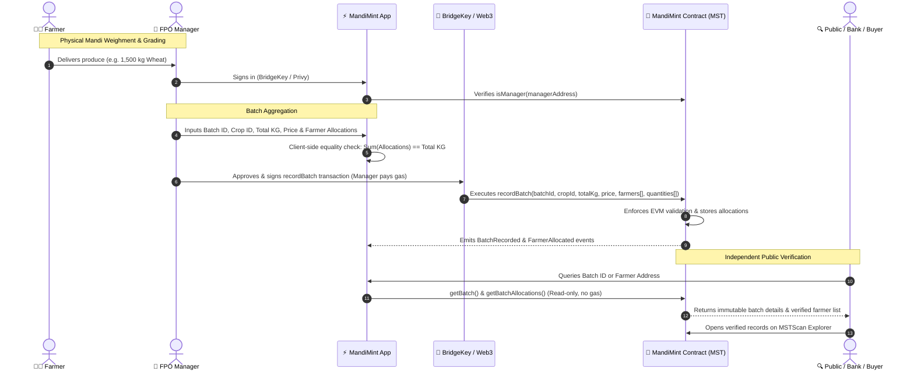
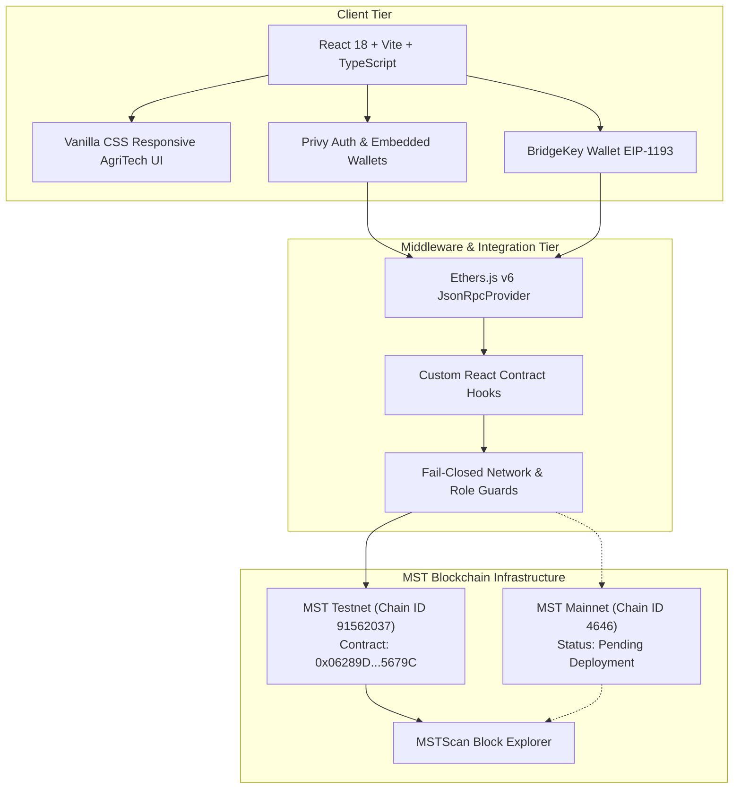

# 🌱 MandiMint · MST Blockchain Buildathon 2.0

> **Decentralized Agricultural Produce Traceability & Cryptographic Recordkeeping on MST Blockchain**  
> Built for the **MST Buildathon 2.0** · Track: *Real-World Use Cases & Enterprise Infrastructure*

[-059669?style=for-the-badge&logo=blockchain&logoColor=white)](https://testnet.mstscan.com/address/0x06289D9c452369abcb9bc1b5D6Adf80982C5679C)
[-blue?style=for-the-badge)](https://mariorpc.mstblockchain.com/)
[](https://bridgekey.io/)
[](https://soliditylang.org/)
[](LICENSE)

---

## 🏆 MST Buildathon 2.0 Submission & Network Summary

| Property | MST Testnet (Live Demonstration) | MST Mainnet (Production Ready) |
|---|---|---|
| **Network Name** | MST Testnet | MST Mainnet |
| **Chain ID** | `91562037` (`0x5752035`) | `4646` (`0x1226`) |
| **RPC Endpoint** | `https://testnetrpc.mstblockchain.com` | `https://mariorpc.mstblockchain.com` |
| **Block Explorer** | [https://testnet.mstscan.com](https://testnet.mstscan.com) | [https://mstscan.com](https://mstscan.com) |
| **Native Currency** | `tMSTC` (18 Decimals) | `MSTC` (18 Decimals) |
| **Contract Name** | `MandiMint.sol` (Solidity 0.8.24) | `MandiMint.sol` (Solidity 0.8.24) |
| **Contract Address** | [`0x06289D9c452369abcb9bc1b5D6Adf80982C5679C`](https://testnet.mstscan.com/address/0x06289D9c452369abcb9bc1b5D6Adf80982C5679C) | **Pending Deployment** *(No address generated)* |
| **Creation Tx Hash** | [`0xb2a1ecfa0766be71652afa34694ec880d2787681745181d0e7cff6cb36adcadf`](https://testnet.mstscan.com/tx/0xb2a1ecfa0766be71652afa34694ec880d2787681745181d0e7cff6cb36adcadf) | None *(No transactions broadcast)* |
| **Deployer / Owner** | [`0xEDe9ca4BfA8e06A1fB832F2F19686b329863CEF0`](https://testnet.mstscan.com/address/0xEDe9ca4BfA8e06A1fB832F2F19686b329863CEF0) | Preflight validated with deployer |
| **Preflight Status** | Complete & Verified on-chain | **PASSED** (Balance: `2.5 MSTC`, Gas Est: `0.000911214 MSTC`) |
| **Deployment Gate** | N/A (Already deployed) | Fail-closed (`CONFIRM_MAINNET_DEPLOYMENT=false`) |

> **Note on Mainnet Deployment Status**: MandiMint's automated Mainnet deployment pipeline has been fully compiled and verified against the live MST Mainnet RPC in read-only preflight mode. No Mainnet transactions have been broadcast, and no Mainnet contract address will exist until explicit governance execution.

---

## 📌 Executive Summary & Agricultural Context

Across India and the Global South, more than **140 million smallholder farmers** sell their crops through physical agricultural market yards known as **APMC Mandis** or through collective **Farmer Producer Organizations (FPOs)**.

### The Problem
1. **Paper J-Forms & Disputed Weighments**: Farmers typically receive paper weight slips or informal verbal receipts at the mandi scale. These records are frequently lost, altered, or disputed by intermediaries during grain aggregation.
2. **Provenance Deficit for Premium Commodities**: High-value crops (such as GI-tagged *Sharbati Wheat*, *Pusa Basmati Rice*, or organic pulses) command significant market premiums. However, once grain bags are commingled at regional mandis, downstream food processors and consumers cannot verify which farmers contributed to the final aggregated batch.
3. **Credit and Subsidy Bottlenecks**: Agricultural credit underwriters and crop insurance agencies struggle to independently audit farmer delivery histories without expensive and slow manual audits.
4. **Crypto Usability Barrier**: Smallholder farmers cannot be expected to purchase cryptocurrencies, manage gas tokens, or sign complex smart contract transactions just to have their harvest recorded.

### The MandiMint Solution
MandiMint is a **decentralized agricultural produce recordkeeping and provenance protocol** built directly on the **MST Blockchain**:
- **Manager-Sponsored On-Chain Minting**: Authorized FPO administrators and mandi managers record incoming agricultural batches. The manager's wallet signs the transaction and pays the native gas fees (`tMSTC` / `MSTC`).
- **Mathematical Mass Conservation**: The smart contract strictly enforces that the sum of all individual farmer allocations equals the total batch weight in whole kilograms ($\sum \text{quantitiesKg} == \text{totalQuantityKg}$). Any mismatch instantly reverts.
- **Zero Friction for Smallholders**: Farmers are identified by their public EVM wallet address. They receive an immutable on-chain record linked to their contribution without submitting transactions or spending gas.
- **Public & Independent Auditability**: Anyone—grain traders, food brands, banks, export inspectors, and consumers—can look up any batch or farmer history on-chain or directly through [MSTScan](https://testnet.mstscan.com) without logging in.

---

## ⚡ Why Blockchain & Why MST Blockchain?

### Why Blockchain?
Agricultural supply chains suffer from information asymmetry between smallholder producers and large commercial aggregators. A centralized database maintained by a single buyer or mandi committee lacks cross-party trust. Blockchain provides:
- **Tamper-Proof Immutability**: Historical batch records, delivery timestamps, and farmer allocations cannot be altered retroactively.
- **Multi-Stakeholder Verification**: Farmers, FPOs, grain millers, banks, and certification bodies all reference the exact same cryptographic ledger.
- **Single Source of Truth**: Eliminates reconciliation disputes between mandi weighbridges and processing facilities.

### Why MST Blockchain?
1. **Ultra-Low Transaction Costs**: Agricultural batch recording involves micro-allocations across multiple farmers. High gas fees on traditional EVM chains would render digital recordkeeping economically unfeasible for smallholder FPOs. MST Blockchain delivers sub-cent, deterministic transaction fees.
2. **High Throughput & Rapid Block Finality**: During peak harvest seasons, mandis process hundreds of truck deliveries daily. MST's consensus architecture handles rapid transaction throughput with immediate finality.
3. **Full EVM Compatibility**: Enables production-grade Solidity smart contracts (`0.8.24`), standard tooling (Hardhat, Ethers.js v6), and established testing frameworks.
4. **BridgeKey Wallet Integration**: Direct compatibility with MST's official [BridgeKey Wallet](https://bridgekey.io/) extension for seamless one-click network addition and transaction signing.
5. **MSTScan Transparency**: Transparent, public block exploration ensures instant auditing for third-party market participants.

---

## ✨ Features: Implemented vs. Planned Roadmap

### Currently Implemented (In This Repository)
- [x] **Smart-Contract Mass Conservation**: Strictly verifies on-chain that $\sum \text{quantitiesKg} == \text{totalQuantityKg}$.
- [x] **Role-Based Access Control**: Contract owner can authorize and revoke FPO manager addresses via `setManager(address, bool)`.
- [x] **Zero-Gas Smallholder Model**: FPO Managers pay all transaction gas; farmers receive indexed on-chain allocation records.
- [x] **Dual-Network Readiness**: Configured for both MST Testnet (live contract `0x0628...5679C`) and MST Mainnet (Chain `4646`).
- [x] **Multi-Wallet Support**: Native support for BridgeKey Wallet (`window.bridgekey`), MetaMask/Injected EVM wallets, and Privy embedded wallets (Phone SMS OTP / Google).
- [x] **Public Blockchain Explorer**: Unrestricted public batch search and farmer allocation lookup without requiring login or wallet connection.
- [x] **Fail-Closed Mainnet Preflight**: Multi-step preflight script validating chain ID, deployer balance, gas estimation, and safety locks before any deployment.
- [x] **Comprehensive Test Suites**: 48 Hardhat smart contract tests + 88 Vitest frontend tests (100% pass rate).

### Planned Features (Future Roadmap)
- [ ] **ERC-2771 / ERC-4337 Gas Sponsorship**: Relayer-based gas abstraction once official relayer infrastructure is standardized across MST networks.
- [ ] **IoT Weighbridge Hardware Integration**: Direct serial/REST interface with automated digital weighbridges to feed tamper-proof scale data to the dApp.
- [ ] **Decentralized Assay Storage (IPFS / Arweave)**: Attaching cryptographic hashes of laboratory moisture and pesticide residue test certificates to batch IDs.
- [ ] **DePIN QR Code Packaging Generation**: Generating dynamic QR codes for retail grain sacks allowing end-consumers to scan and view farmer provenance.
- [ ] **Multi-Signature FPO Governance**: Gnosis Safe-style multi-sig approval for large commercial grain consignments exceeding 100 metric tonnes.

---

## 🔄 User Journeys & Operational Workflows



### Detailed Steps:
1. **Farmer Sign-In & Onboarding**:
   - Farmers can log in using their phone number (SMS OTP) or Google via Privy, automatically generating an EVM embedded wallet, or connect an existing Web3 wallet.
   - The farmer's public EVM address acts as their decentralized agricultural identifier.
2. **FPO Manager Authorization**:
   - The contract owner executes `setManager(managerAddress, true)` to whitelist an FPO manager.
   - The frontend's `useAuthoritativeRole` hook checks `isManager` on-chain to unlock the Manager Workspace.
3. **Recording Agricultural Batches**:
   - The manager inputs: Unique Batch ID, Crop ID (e.g., `1` for Wheat, `2` for Basmati), Total Quantity (kg), Sale Price (INR/Tonne), and a list of farmer addresses with their respective kilogram contributions.
   - The form mathematically prevents submission unless $\sum \text{Farmer Quantities} == \text{Total Quantity}$.
   - The manager submits the transaction and pays the nominal gas fee in `tMSTC`.
4. **On-Chain Batch & Farmer Verification**:
   - Any external party navigates to the **Batch Lookup** or **Farmer History** tab.
   - The page queries `getBatch(batchId)` and `getFarmerAllocations(farmerAddress)` directly from the blockchain.
   - Direct links allow cross-referencing on [MSTScan](https://testnet.mstscan.com).

---

## 🏗️ System Architecture & Technology Stack



### Technology Stack:
- **Smart Contracts**: Solidity `0.8.24`, Hardhat `2.29.1`, `@nomicfoundation/hardhat-ethers` `^3.1.3`.
- **Frontend Framework**: React `18.3.1`, TypeScript `5.6.2`, Vite `7.3.7`.
- **Blockchain Library**: Ethers.js `6.17.0` (with static network providers and fail-closed RPC fallbacks).
- **Authentication & Wallets**:
  - [BridgeKey Wallet](https://bridgekey.io/) (`window.bridgekey` or injected `window.ethereum`).
  - [Privy](https://privy.io) (`@privy-io/react-auth` `^2.4.7`) for phone SMS OTP & Google embedded onboarding.
- **Styling**: Tailored AgriTech Design System with responsive mobile layouts and custom backdrop imagery (`frontend/public/agriculture_hero.jpg`).
- **Testing & Quality**: Vitest `3.2.7`, Chai `4.5.0`, ESLint `9.15.0`.

---

## 🔐 Smart-Contract Deep Dive (`MandiMint.sol`)

### Storage Structures
```solidity
struct Batch {
    uint256 batchId;              // Unique, nonzero identifier
    uint256 cropId;               // Canonical crop code (e.g. 1 = Wheat, 2 = Basmati)
    uint256 totalQuantityKg;      // Conserved total weight in whole kilograms
    uint256 salePriceInrPerTonne; // Price in whole INR per metric tonne (1,000 kg)
    uint256 createdAt;            // Block timestamp of creation
    address manager;              // Address of authorized manager who submitted batch
    bool exists;                  // Explicit existence guard
}
```

### Access Control Modifiers
```solidity
modifier onlyOwner() {
    if (msg.sender != owner) revert NotOwner();
    _;
}

modifier onlyManager() {
    if (!isManager[msg.sender]) revert NotManager();
    _;
}
```

### `recordBatch` Strict Validation Pipeline
When an authorized manager calls `recordBatch()`, the contract executes a comprehensive validation check before committing any state to storage:
1. `batchId != 0` (reverts with `ZeroBatchId`)
2. `!_batches[batchId].exists` (reverts with `BatchAlreadyExists`)
3. `cropId != 0` (reverts with `ZeroCropId`)
4. `totalQuantityKg != 0` (reverts with `ZeroTotalQuantity`)
5. `salePriceInrPerTonne != 0` (reverts with `ZeroSalePrice`)
6. `farmers.length > 0` && `quantitiesKg.length > 0` (reverts with `EmptyAllocations`)
7. `farmers.length == quantitiesKg.length` (reverts with `ArrayLengthMismatch`)
8. Each `farmer != address(0)` (reverts with `ZeroFarmerAddress`)
9. Each `quantityKg > 0` (reverts with `ZeroAllocation`)
10. No duplicate farmer in the same batch (quadratic iteration check reverts with `DuplicateFarmer`)
11. **Mass Conservation**: $\sum \text{quantitiesKg} == \text{totalQuantityKg}$ (reverts with `AllocationTotalMismatch`)

### Events Emitted
- `event BatchRecorded(uint256 indexed batchId, uint256 indexed cropId, address indexed manager, uint256 totalQuantityKg, uint256 salePriceInrPerTonne, uint256 farmerCount, uint256 createdAt)`
- `event FarmerAllocated(uint256 indexed batchId, address indexed farmer, uint256 quantityKg)`
- `event ManagerUpdated(address indexed manager, bool authorized)`

### Read-Only Inspection Functions
- `getBatch(batchId)`: Returns batch details or reverts with `BatchNotFound`.
- `getBatchAllocations(batchId)`: Returns arrays of farmer addresses and allocated kilograms.
- `getFarmerAllocation(batchId, farmer)`: Returns the specific quantity for a farmer in a batch.
- `getFarmerBatches(farmer)`: Returns all batch IDs where a farmer participated.
- `getFarmerAllocations(farmer)`: Returns parallel arrays of batch IDs and allocated quantities for a farmer.

### Security Assumptions & Deliberate Design Decisions
- **Reentrancy Immunity**: `recordBatch` performs zero external contract calls and transfers no native or ERC-20 tokens. State storage occurs strictly within the contract scope.
- **Append-Only Immutability**: There is no delete, edit, or override function. Once recorded, an agricultural batch cannot be modified by any manager or the contract owner.
- **Public EVM Ledger**: Farmer wallet addresses and allocated weights are publicly readable. Sensitive personal identifying information (such as Aadhaar numbers or personal contact details) is deliberately **NOT** stored on-chain.
- **Off-Chain Metadata Mapping**: Crop names and Mandi yard locations are mapped off-chain using standardized canonical identifiers (e.g. `cropId = 1` for Wheat).

---

## 🌐 Network Configuration Reference

### MST Testnet (Chain ID `91562037`)
- **Network Name**: `MST Testnet`
- **RPC URL**: `https://testnetrpc.mstblockchain.com`
- **Chain ID**: `91562037` (`0x5752035`)
- **Currency Symbol**: `tMSTC`
- **Block Explorer**: `https://testnet.mstscan.com`
- **Faucet**: `https://faucet.mstblockchain.com`
- **Deployed MandiMint Contract**: `0x06289D9c452369abcb9bc1b5D6Adf80982C5679C`

### MST Mainnet (Chain ID `4646`)
- **Network Name**: `MST Mainnet`
- **RPC URL**: `https://mariorpc.mstblockchain.com`
- **Chain ID**: `4646` (`0x1226`)
- **Currency Symbol**: `MSTC`
- **Block Explorer**: `https://mstscan.com`
- **Deployment Status**: **Pending Governance Deployment**
- **Preflight Verification**: Complete (balance `2.5 MSTC`, gas estimate `0.000911214 MSTC`).

---

## 💻 Local Development & Installation

### Prerequisites
- **Node.js**: Node 24 Active LTS or Node 22 Maintenance LTS
- **npm**: 10+ or 11+
- **Browser Extension**: [BridgeKey Extension](https://bridgekey.io/) or MetaMask

### 1. Clone the Repository
```bash
git clone https://github.com/RASHISADIYA/MandiMint.git
cd MandiMint
```

### 2. Install Root & Frontend Dependencies
```bash
npm install
npm install --prefix frontend
```

### 3. Configure Local Environment
Copy `.env.example` to `.env`:
```powershell
Copy-Item .env.example .env
Copy-Item frontend/.env.example frontend/.env.local
```

### 4. Start Local Blockchain (Optional)
To test against a local Hardhat node:
```bash
npm run node
```
In a second terminal, deploy locally:
```bash
npm run deploy:local
```

### 5. Launch the Frontend Development Server
```bash
npm run dev
```
Open [http://localhost:5173](http://localhost:5173) in your browser.

---

## ⚙️ Environment Variables Reference

### Root Environment (`.env`)
Used by Hardhat deployment scripts and contract verification:
```ini
# MST Testnet Configuration
MST_TESTNET_RPC_URL="https://testnetrpc.mstblockchain.com"
MST_TESTNET_CHAIN_ID="91562037"
MANDIMINT_CONTRACT_ADDRESS="0x06289D9c452369abcb9bc1b5D6Adf80982C5679C"

# Deployer / Manager Private Key (Never commit real keys!)
MST_TESTNET_DEPLOYER_PRIVATE_KEY=""

# MST Mainnet Configuration
MST_MAINNET_RPC_URL="https://mariorpc.mstblockchain.com/"
MST_MAINNET_CHAIN_ID="4646"
MST_MAINNET_DEPLOYER_PRIVATE_KEY=""

# Safety Gate: Must be explicitly 'true' to broadcast mainnet transactions
CONFIRM_MAINNET_DEPLOYMENT="false"
```

### Frontend Environment (`frontend/.env.local`)
Exposed to Vite client bundle. **Never place private keys or secrets here:**
```ini
VITE_PRIVY_APP_ID="your-privy-app-id"
VITE_MST_TESTNET_CHAIN_ID="91562037"
VITE_MST_TESTNET_RPC_URL="https://testnetrpc.mstblockchain.com"
VITE_MST_TESTNET_EXPLORER_URL="https://testnet.mstscan.com"
VITE_MST_TESTNET_CURRENCY_SYMBOL="tMSTC"
VITE_MANDIMINT_CONTRACT_ADDRESS="0x06289D9c452369abcb9bc1b5D6Adf80982C5679C"
```

---

## 🧪 Testing, Linting & Build Verification

MandiMint enforces strict quality gates across smart contracts and the frontend application:

### 1. Smart Contract Test Suite (Hardhat + Chai)
```bash
npm test
```
- **Result**: `48 passing (2s)`
- **Coverage**: Access control, manager whitelist, zero-address checks, array bounds, duplicate farmer rejection, mass conservation equality, allocation arithmetic, and event emissions.

### 2. Frontend Unit & Integration Tests (Vitest)
```bash
npm run test:frontend
```
- **Result**: `12 test files passed, 88 tests passed`
- **Coverage**: Multi-network provider switching, role resolution, EIP-1193 wallet event handling, mass conservation UI validation, phone number formatting, and honest on-chain batch data mapping.

### 3. ESLint Code Quality
```bash
npm run lint
```
- **Result**: `0 errors, clean pass across all React components and hooks`.

### 4. Production Build & TypeScript Type Checking
```bash
npm run build
```
- **Result**: `tsc -b && vite build` completed successfully, producing an optimized production bundle in `frontend/dist/`.

---

## 📁 Repository Structure

```text
MandiMint/
├── contracts/
│   └── MandiMint.sol              # Core Solidity 0.8.24 smart contract
├── deployments/
│   └── mstTestnet/
│       ├── MandiMint.json         # Verified Testnet deployment metadata
│       └── transactions.json      # Testnet transaction ledger
├── frontend/
│   ├── public/
│   │   ├── agriculture_hero.jpg   # Responsive backdrop asset
│   │   └── favicon.svg            # MandiMint brand icon
│   ├── src/
│   │   ├── auth/                  # Privy authentication & onboarding flows
│   │   ├── components/            # Reusable UI components & layouts
│   │   ├── config/                # Network definitions (Testnet 91562037 & Mainnet 4646)
│   │   ├── hooks/                 # React hooks for smart contract reads & writes
│   │   ├── lib/blockchain/        # Contract ABI and ethers provider wrapper
│   │   ├── pages/                 # Route pages (Landing, Lookup, Record, Dashboard)
│   │   └── styles/                # Global AgriTech styling system
│   ├── package.json
│   └── vite.config.ts
├── scripts/
│   ├── authorize-manager.js       # CLI script to whitelist FPO managers
│   ├── deploy-mainnet.js          # Fail-closed MST Mainnet deployment & preflight
│   ├── deploy.js                  # MST Testnet deployment script
│   └── deploy-guard.js            # Anti-duplicate deployment validation guard
├── test/
│   ├── MandiMint.test.js          # Smart contract test suite (48 tests)
│   └── deploy-guard.test.js       # Deployment guard test suite
├── .env.example                   # Root environment variable template
├── .gitignore                     # Git ignore rules (.env, .env.*, secrets ignored)
├── hardhat.config.js              # Hardhat configuration for MST networks
├── package.json                   # Root workspace scripts and dependencies
└── README.md                      # Buildathon submission documentation
```

---

## ⚠️ Important Implementation Limitations & Disclosures

For complete transparency with Buildathon judges and community developers:
1. **Gas Sponsorship**: MandiMint does **not** currently implement ERC-2771 meta-transactions or gasless relayers. The authorized FPO Manager’s wallet must be funded with native coins (`tMSTC` or `MSTC`) to pay gas fees when executing `recordBatch`.
2. **Farmer Participation**: Farmers do not submit transactions in the current MVP workflow. Their wallet address is recorded on-chain by the FPO Manager as a beneficiary of the batch allocation.
3. **Data Privacy**: All data written to `MandiMint.sol` (wallet addresses, batch quantities, crop codes, sale prices) is publicly readable on the blockchain. Personal farmer records, phone numbers, and identity documents are deliberately omitted from on-chain state.
4. **Off-Chain Metadata**: Agricultural Mandi yard names and commodity varieties are mapped off-chain using the canonical `cropId` field.
5. **No Illustrative / Hardcoded Data**: Live batch lookup queries the deployed contract on MST Testnet. The application does not present hardcoded mock batches as live blockchain records.
6. **Auditing**: While the smart contract has been thoroughly unit tested with 100% test pass rates and zero external dependencies, no formal third-party security audit has been performed.

---

## 🎨 Visual Assets & User Interface

The MandiMint interface incorporates a dedicated AgriTech visual identity tailored to Indian agricultural market yards:
- **Hero Image**: [frontend/public/agriculture_hero.jpg](frontend/public/agriculture_hero.jpg)
- **Brand Favicon**: [frontend/public/favicon.svg](frontend/public/favicon.svg)
- **Design Principles**: High-contrast, mobile-responsive layouts built to support rural tablet and mobile devices in bright daylight mandi yards.

---

## 📄 License & Hackathon Information

- **Project**: MandiMint
- **Event**: MST Blockchain Buildathon 2.0
- **Track**: Real-World Use Cases & Enterprise Infrastructure
- **License**: [MIT](LICENSE)
- **Repository**: [https://github.com/RASHISADIYA/MandiMint](https://github.com/RASHISADIYA/MandiMint)
